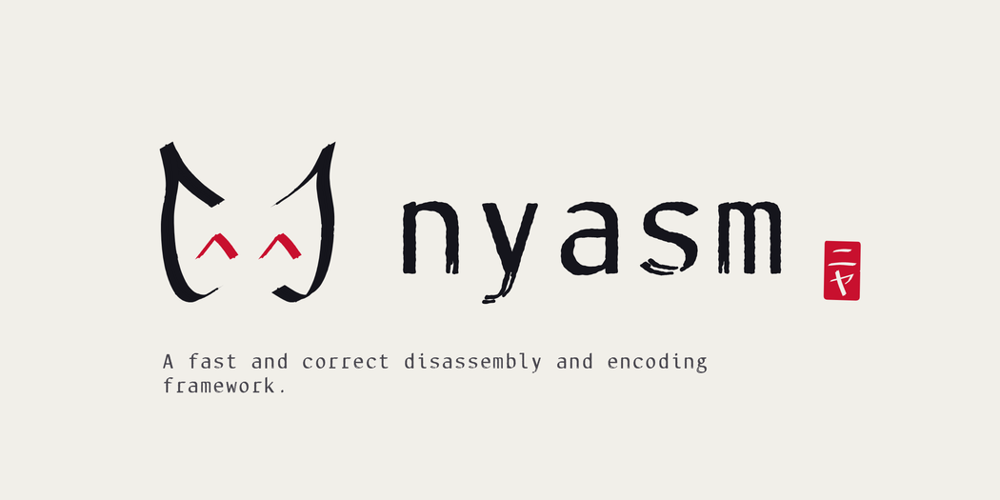

  

Supports **x86** (16, 32 and 64-bit), **AArch64**, **AArch32** (A32/T32), **RISC-V** (RV32/RV64) and **CIL**.

> [!WARNING]
> nyasm is under active development. The decode and encode APIs are about to change, and an asmjit-style
> assembler frontend is a work in progress. Expect breaking changes between releases.

With ❤️ from pushfq 🇦🇺

